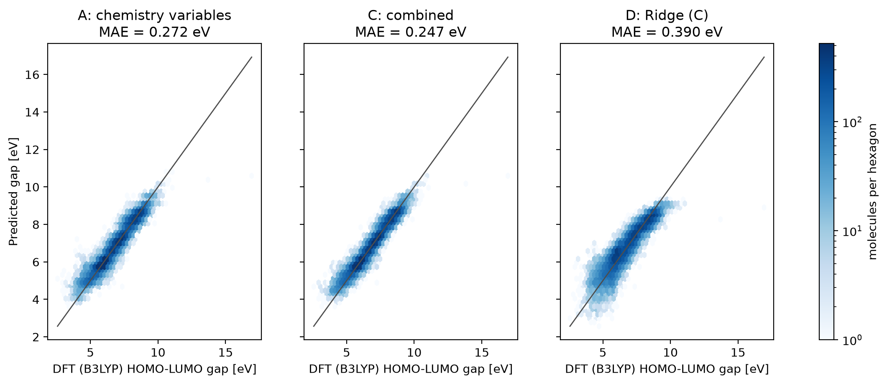
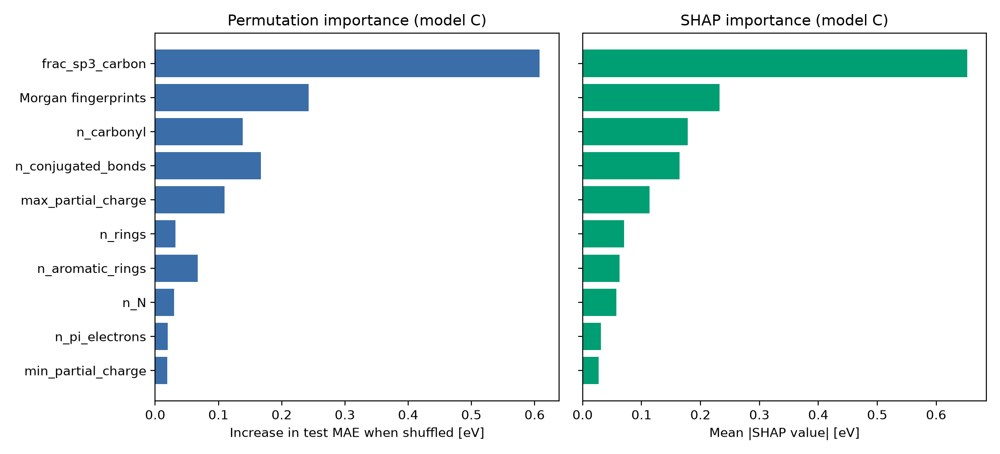
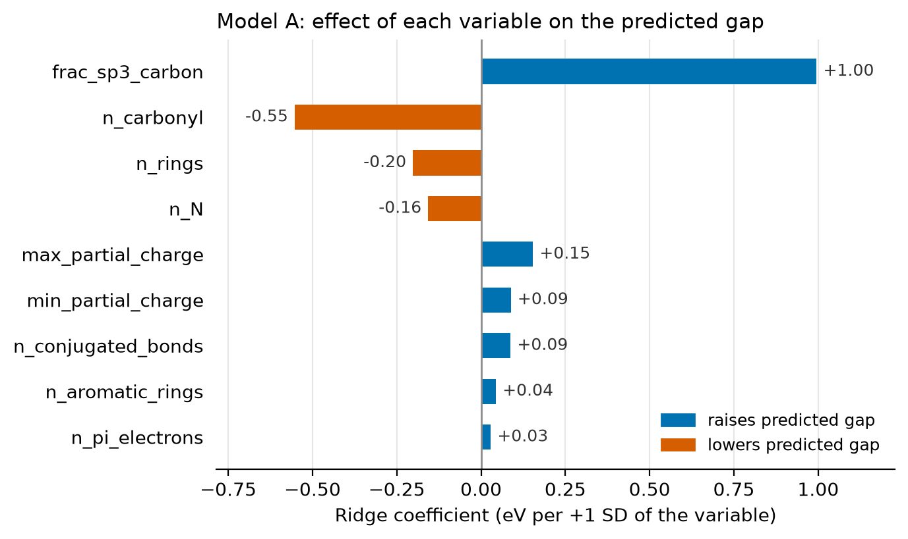
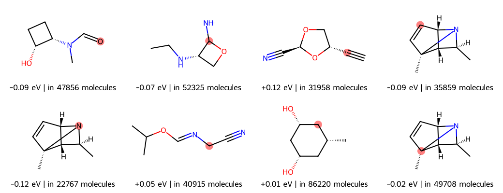
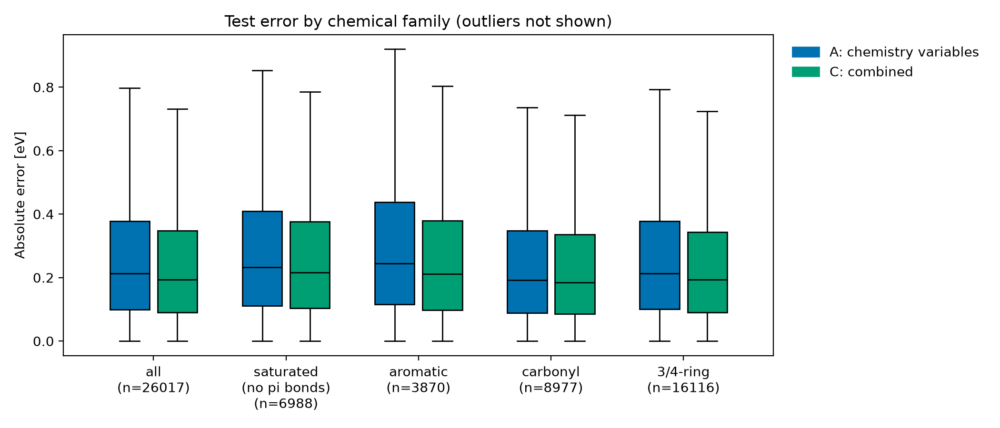
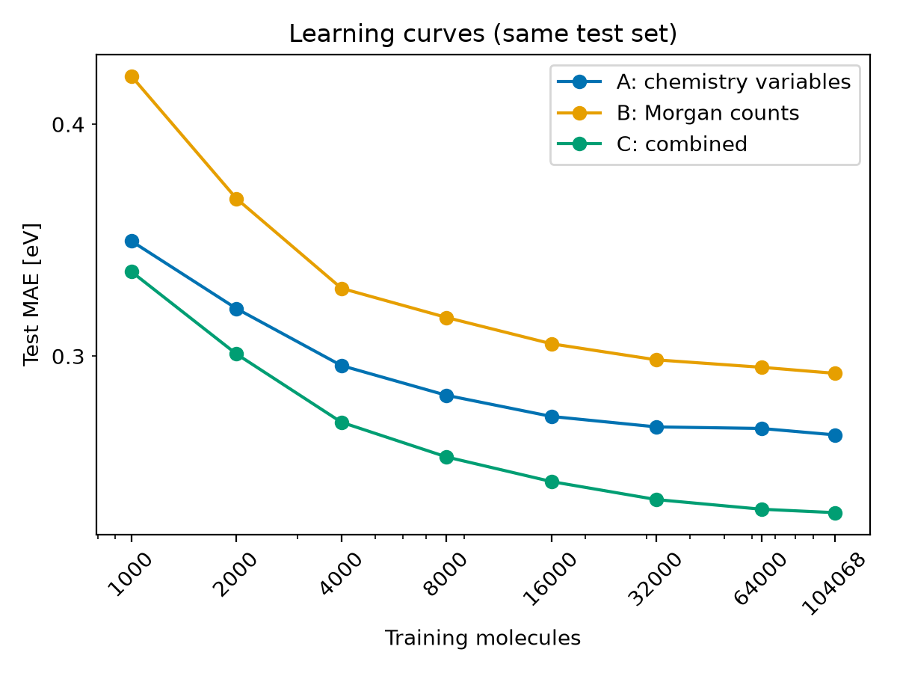

# Predicting HOMO–LUMO gaps of small molecules (QM9)
BERN02 machine-learning final project, Lund University, 2026. Keywords: QM9, HOMO–LUMO gap, machine learning, RDKit, scikit-learn, SHAP, FAIR.
## What this project does
We predict the DFT HOMO–LUMO gap (eV, B3LYP) of the ~130,000 molecules in QM9 from features derived only from their SMILES strings, and ask which structural features drive the gap. We then test how well the trained models extrapolate to aspirin (13 heavy atoms; QM9 has at most 9) by comparing the ML prediction with an ORCA DFT calculation. The models are surrogates of B3LYP: they learn its values, not experiment.
QM9 (Ramakrishnan et al., 2014), CC0: https://doi.org/10.6084/m9.figshare.c.978904.v5. Expected layout:
data/qm9/dsgdb9nsd.xyz/        # 133,885 .xyz files
data/qm9/uncharacterized.txt   # molecules flagged by the QM9 authors
data/qm9/qm9_readme.txt        # QM9 file-format description

Cleaning: remove the uncharacterized molecules, drop SMILES that RDKit cannot parse, merge duplicate canonical SMILES (mean gap). About 130,000 molecules remain.

## How to run
bash
uv sync        # creates .venv with the locked package versions
Open gap_model.ipynb, select the .venv kernel and run all cells. All settings are at the top of the notebook; outputs are written to results/gap_N/ (one folder per run).

## Method
* Inputs: A = chemistry variables from RDKit; B = Morgan substructure counts (radius 2, top 256 from the training set); C = A + B.
* Models: HistGradientBoosting (A, B, C) and Ridge regression (D; variables C, penalty chosen by 5-fold cross-validation inside the training set).
* Evaluation: random 80/20 split, fixed seed (42); MAE, RMSE and R². Scores: .
* Interpretation: SHAP and permutation importance for the trees, coefficients for Ridge.

## Results

* Predicted vs DFT gap on the test set

* Which variables matter

* Which substructures matter (label = mean SHAP effect on the predicted gap)

* Where the models fail

* Effect of training-set size

## Extrapolation test: aspirin
In progress. The ML prediction for aspirin will be compared with an ORCA reference calculation (B3LYP/G 6-31G(2df,p), the same level of theory as QM9). The structure is built with LGV (Lund University, not yet released) and exported as .xyz.

## Limitations
* Training data: ≤ 9 heavy atoms, C/H/O/N/F, neutral molecules; aspirin is outside this range.
* SMILES features cannot see 3D conformation.
* The target is a computed B3LYP orbital-energy difference, not a measured optical gap.

## Licence and FAIR
Code: MIT (LICENSE). Our results and figures: CC BY 4.0. QM9: CC0. See FAIR.md for the FAIR reflection.

## Reference
Ramakrishnan, R., Dral, P. O., Rupp, M., & von Lilienfeld, O. A. (2014). Quantum chemistry structures and properties of 134 kilo molecules. Scientific Data, 1, 140022. https://doi.org/10.1038/sdata.2014.22
